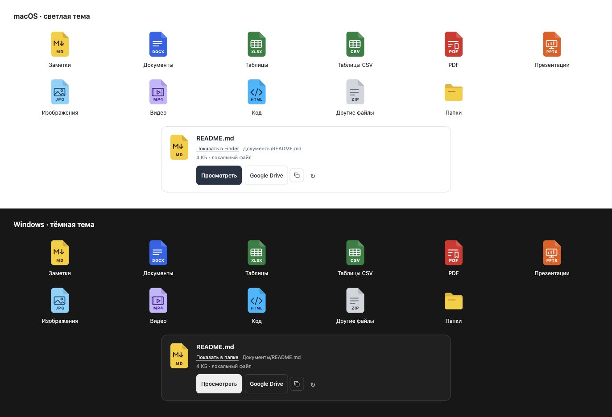

# Vault Files

Карточки файлов с просмотром рядом с чатом BB и кнопкой перехода к существующей копии в Google Drive. Плагин можно использовать с Obsidian vault или обычной папкой документов.

**[Инструкция с описанием настроек](docs/GUIDE.md)** — как установить, настроить и пользоваться.


## Возможности

- Библиотека папок в боковой панели BB и во вкладке рядом с чатом.
- Карточки в ответах агентов: имя, размер, путь, кнопки просмотра и Google Drive.
- Клик по пути с подписью «Показать в Finder» выделяет файл в папке на Mac, где хранится vault. В Windows используется «Показать в папке» с выделением файла в Проводнике; в Linux открывается содержащая папка.
- Кнопка рядом с Google Drive копирует точную ссылку и сообщает результат.
- Markdown и текст в режиме чтения с переключением на исходник.
- Открытие остальных форматов через просмотрщики BB. Для Word, таблиц и презентаций нужен отдельный Office Viewer; он не входит в этот пакет.
- Собственные SVG-значки с загнутым уголком и символом типа файла: MD — жёлтый; DOC/DOCX — синий; таблицы, включая CSV, — зелёный; PDF — красный; презентации — оранжевый; изображения — голубой; видео — лавандовый; код, включая HTML, — кислотно-синий. Неизвестные расширения — серые.
- Общая инструкция для агентов всех проектов и провайдеров. Карточки появляются, когда агент использует инструмент или соответствующую директиву; старые сообщения автоматически не переписываются.

## Требования

BB 0.46 или новее с Plugin SDK 0.6.49–0.6.x. Python 3 на компьютере, где хранится папка. Локальная библиотека работает на macOS, Windows и Linux. В Windows нужен Python 3 с launcher py или добавлением в PATH.

Для поиска существующих копий Google Drive нужен macOS или Windows с синхронизацией через Google Drive for Desktop. Плагин читает локальный индекс без OAuth или API-ключа. Индекс DriveFS — внутренний формат Google, который может измениться.

Без синхронизации выберите в настройках, создавать ли копии файлов в Google Drive. «Да, всегда» поручает агенту выгружать каждый основной выдаваемый файл через его отдельно подключённый Google Drive-коннектор с инструментами загрузки и обновления. Сам плагин не получает OAuth-токены и не подключает аккаунт. Если инструмент недоступен или загрузка не удалась, агент должен сообщить об этом, без фиктивной ссылки. «Нет» запрещает новые копии; до первого выбора загрузка также запрещена.

Укажите целевой аккаунт в настройках. После успешной загрузки агент регистрирует точную ссылку и SHA-256 исходного файла. При изменении файла обновляется та же копия. Просмотр карточек не запускает загрузку, весь vault фоном не отправляется. Существующая синхронизация используется без дублей; права доступа не меняются.

## Установка из архива

Распакуйте архив в постоянную папку. Если у Вас есть агент в BB, передайте ему эту папку и попросите: «Установи этот плагин и настрой на мою папку документов». Агент может выполнить необходимые команды сам.

Для ручной установки из исходников, когда Node.js/npm уже установлены:

```sh
cd /path/to/bb-plugin-vault-files
npm ci --ignore-scripts
bb plugin install .
```

Папку установленного плагина нужно сохранить: BB использует её как источник. Для Git-установки BB загружает зависимости и собирает пакет самостоятельно.

## Первичная настройка

Откройте настройки установленного Vault Files и укажите путь к своей папке vault. Google Drive необязателен: без него локальный просмотр работает.

Чтобы добавить кнопку Drive, вставьте ссылку на **ту же корневую папку** в Google Drive. При нескольких аккаунтах укажите нужный аккаунт, чтобы ссылка открывалась в нём. По умолчанию файлы читаются на основном компьютере BB; для другой подключённой машины можно задать её идентификатор в дополнительном поле.

Пример настройки через агента или CLI с демонстрационными значениями:

```sh
bb vault-files setup --root '/path/to/vault' --drive-folder 'https://drive.google.com/drive/folders/YOUR_FOLDER_ID' --account 'you@example.com'
```

Открывайте «Файлы vault» из боковой панели или списка действий новой вкладки справа.

## Для агентов

```sh
bb vault-files prepare 'Projects/notes.md' --json
bb vault-files list 'Projects' --json
```

Также доступен инструмент `vault_file_link`. Он возвращает директиву карточки:

```text
::vault-file{path="Projects/notes.md"}
```

Выводите её отдельной строкой. Дублирующие текстовые ссылки под карточкой не нужны. Файлы вне выбранного vault показывайте обычной локальной ссылкой.

## Ограничения и приватность

Настройки папки, аккаунта и компьютера хранятся в собственном BB пользователя и не входят в пакет. Плагин не пишет в vault; облачные копии создаются агентом только при выборе «Да, всегда». Скрытые служебные пути и выход за пределы выбранной папки закрыты. Для просмотра через другое устройство компьютер с vault должен оставаться включённым и подключённым к BB.

Найденная запись Drive подтверждает адрес копии, но не синхронизацию последней правки. При неоднозначном совпадении ссылка не выбирается. Библиотека показывает до 250 элементов текущей папки, текстовый просмотр ограничен 2 МБ. Если папку перенесли или Drive изменил индекс, настройку потребуется проверить.

## Разработка

```sh
npm ci --ignore-scripts
npm run generate
npm run typecheck
npm test
npm run test:python
npm run build
```

`drive_lookup.py` — исходник моста к индексу. Перед сборкой `generate-lookup.mjs` включает его в самостоятельный host-бандл. Лицензия MIT.

## Значки



Исходный набор нарисован для этого плагина и распространяется по MIT вместе с кодом. `file-icons.tsx` задаёт форму, цвета и расширения; `assets/icons/` содержит отдельные SVG-примеры. При проектировании изучены [Fluent Iconography](https://fluent2.microsoft.design/iconography/) и [Lucide](https://lucide.dev/): простые узнаваемые символы и единая геометрия. Сторонние SVG и логотипы приложений не включены.
